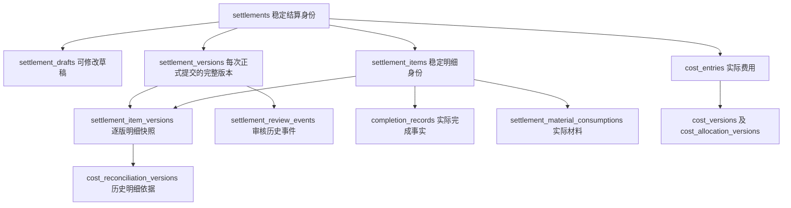

> **阶段历史记录，非最新建库规范。** 物资主数据现已按新裁决版本化，实际完工、领退、费用不再依附于结算。最新结构以 [权威 Schema 113 设计](数据库V3_Schema113_统一结构设计与无技术债审计_2026-11-07.md) 和 [候选 SQL](../../server/database/schema/schema113.sql) 为准。

> **2026-11-07 唯一当前候选已更新**：本文件仅供历史追溯。请以[数据库V3_Schema113_统一结构设计与无技术债审计_2026-11-07.md](数据库V3_Schema113_统一结构设计与无技术债审计_2026-11-07.md)及最新 SQL 为准。

# 数据库 V3 · Schema 113 候选：完整历史版本设计

> **2026-11-06 · 已调整候选 SQL，未替换运行库。**
> [完整候选 SQL](../../server/database/schema/schema113.sql)；当前可运行版本仍为 Schema 112。
> 本轮仅修改数据库候选设计，不改前端、服务端应用代码和真实数据。

## 一、历史管理总原则

采用**稳定业务身份 + 不可变完整版本 + 业务审核事件**，不是仅记录版本数字或仅追加金额差额。

| 对象 | 历史表 | 保留内容 |
| --- | --- | --- |
| 年度框架与执行协议 | `framework_versions`、`agreement_versions` | 额度、名称、状态及其调整依据 |
| 子项目 | `project_approval_versions`、`project_stage_events`、`project_change_orders` | 入库、立项、项目批准、变更、关闭 |
| 项目批准需求范围 | **`project_approval_scope_versions`** | 每次批准的需求量、金额、需求版本和快照 |
| 项目物资快照 | `project_approval_material_items` | 型号、规格、数量、单位、来源 |
| 专业需求 | `demand_revisions` | 需求位置、操作、工作量及相关物资快照 |
| 操作类型与标准作业对象 | `operation_versions`、**`work_object_versions`** | 单位、适用对象、字段定义 |
| 参考价 | `reference_price_versions` | 历次单价与定价条件 |
| 线路、杆塔、档距 | `line_name_history`、`logical_tower_name_history`、`logical_tower_physical_history` 等 | 改名、改号及共塔实体关联历史；完整拓扑版本另待完善 |
| **结算单及明细** | **`settlement_versions`、`settlement_item_versions`、`settlement_review_events`** | 每次正式提交的完整版本、明细及审核链 |
| 实际完成量 | `completion_records`、`completion_revisions` | 现场验收和更正，不随财务结算变化 |
| 实际物资消耗 | `settlement_material_consumptions`、**`settlement_material_consumption_revisions`** | 超领、追加、修正、作废 |
| 实际费用与分摊 | `cost_versions`、**`cost_allocation_versions`** | 当前真实费用与每次分摊历史 |
| 费用核对 | `cost_reconciliation_versions` | 明确记录所引用的历史结算明细版本 |
| 子项目关闭 | `project_closures`、`project_closure_dispositions` | 关闭时的处置责任与证据 |
| 通用用户操作 | `audit_events` | 操作责任，不保存每次草稿按键 |

## 二、结算业务结构



| 表 | 主字段 | 职责 |
| --- | --- | --- |
| `settlements` | `id, project_id, number, created_by, created_at` | 结算单的永久身份，不直接存可覆盖的审核状态或金额 |
| `settlement_drafts` | `settlement_id, based_on_version_id, draft_json, edit_version` | 草稿随时编辑，不参与当前有效账 |
| `settlement_versions` | `id, settlement_id, version_no, previous_version_id, approval_version_id, kind, change_type, reason, settlement_on` | 每次正式提交的完整不可变版本；initial/revision/void |
| `settlement_items` | `id, settlement_id, project_scope_id` | 明细永久身份，即使在后续新版删除该项也保留历史 |
| `settlement_item_versions` | `settlement_version_id, settlement_item_id, approval_scope_version_id, quantity_scaled, amount_fen, unit_price_fen, evidence, scope_snapshot_json` | 版本中所有明细的**完整快照**，不是单独的金额差 |
| `settlement_review_events` | `settlement_version_id, event_seq, action, actor_id, recorded_at, effective_on` | submit、return、reject、approve 审核动作；系统时间与生效日分别保存 |

每条结算明细历史版本必须引用同一结算单、同一子项目和**该次结算采用的项目批准版本**。已提交的历史内容冻结，修改必须形成新的完整版本；不能修改旧版本的行记录。费用核对绑定当时的 `settlement_item_version_id`，不会在最新版修改后自动改写。

## 三、当前有效版本与时点历史

| 视图 | 语义 |
| --- | --- |
| `v_settlement_review_status` | 每个正式版本最后一次审核动作与批准记录 |
| `v_settlement_workflow` | 最新提交版本状态，同时展示此前已生效版本 |
| `v_settlement_effective_versions` | **每份结算最多一个**最新批准完整版本 |
| `v_effective_settlement_items` | 只统计当前有效版本明细，作废版不产生净结算金额 |
| `v_settlement_approval_timeline` | 记录所有历史批准事件的系统记录时间、生效日期 |
| `v_cost_reconciliation_freshness` | 费用核对引用的旧结算版本是否与当前一致 |
| `v_material_consumption_current`、`v_cost_allocation_current` | 材料和分摊只计算各自最新有效版本 |

**禁止将多次结算历史版本金额直接相加。** 待审批新版本对报表没有作用，只有审核通过的新完整版本才替换旧版本。

以当时系统已知情况还原历史结算：

```sql
SELECT settlement_version_id, version_no, recorded_at, effective_on
FROM v_settlement_approval_timeline
WHERE settlement_id=:id AND recorded_at<=:as_known_at
ORDER BY version_no DESC LIMIT 1;
```

再按返回的 `settlement_version_id` 查询 `settlement_item_versions`，即可还原当时所有有效明细。业务日期和登记日期分开保留，不可把后补的业务生效日期当成系统早已知道的时间。

## 四、完整版本实例

| 版本 | 审核与变动 | 当前有效净结算 |
| --- | --- | ---: |
| V1 | 首次确认 8,000 分 | 8,000 分 |
| V2 | 改为 10,500 分，但审核退回 | 仍为 8,000 分 |
| V3 | 修改为 9,300 分并批准 | **9,300 分** |
| V4 | 正式注销并批准 | **0 分** |

历史 V1、V2、V3、V4 全部保留，但报表不相加。V4 注销只影响结算事实，**不擦除现场验收、已经领用的材料与真实费用**。若实际完成数量超过需求预计，则显示超过 100% 的比例、差额、超出量，而不是拒绝保存。

## 五、项目范围、物资和费用的版本

- `project_approval_scope_versions` 保留每次项目批准的需求基准；已有批准快照后，`project_demand_scopes` 正式字段不允许直接覆盖。
- `project_approval_material_items` 保留当时批准的物资预计数量；实际用料可以超预计，继续统计偏差。
- `settlement_material_consumption_revisions` 更正或撤销领料，`v_material_consumption_current` 只取最新版本，避免重复累计。
- `cost_allocations` 为稳定分摊身份；`cost_allocation_versions` 保留每次分摊，`v_cost_allocation_current` 只取最新有效版本。
- `cost_reconciliation_versions` 通过复合外键同时关联稳定明细和其正式历史版本；`v_cost_reconciliation_freshness` 标明核对是否引用当前有效结算版本。

## 六、SQLite 验证与实施范围

已在内存 SQLite 进行正式版本提交、退回、再批准、注销验收，验证 V1 8,000、V2 不生效、V3 9,300、V4 0 的全流程；实际验收 200% 合法保存；物资从 2,000 更正至 3,200 后只计算 3,200；费用分摊从 5,000 更正至 7,000 后只计算 7,000；历史 V1 核对在 V3 生效后仍可追溯。

**待进一步完善**：附件文件如何与每次结算审核版本建立不可变外键；全量线路拓扑版本；跨正式子项目需求承接例外；关闭后的授权补录与完整并发／断电验收。当前仅为候选 DDL，不代表应用代码和真实数据库已经升级。
