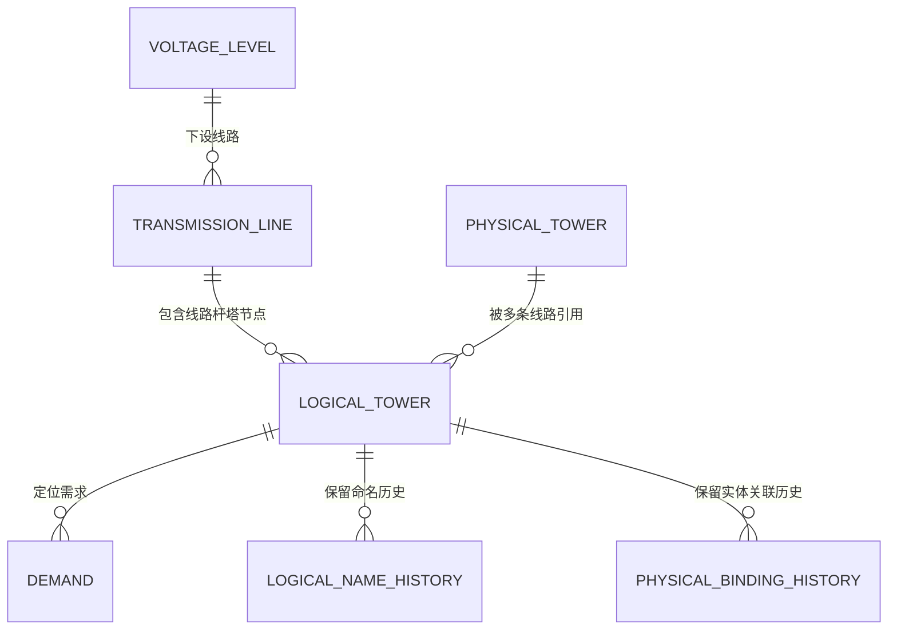

# 线路、物理杆塔与逻辑杆塔数据库设计

版本：V1.0，设计评审稿  
日期：2026年10月29日  
适用：本地服务器 + SQLite；作为主功能设计文档第4章的详细设计。本次仅形成设计及SQL草案，未创建正式业务数据库。

## 1. 核心关系

**物理杆塔表示实际资产；逻辑杆塔表示这基塔在线路上的身份和命名。**



每个正式启用的逻辑杆塔属于一条线路，并引用一个物理杆塔。一个物理杆塔可以被多条线路的多个逻辑杆塔引用，回数不设固定上限。

这实质上是“线路与物理杆塔的多对多关系”，逻辑杆塔同时承担关联和业务身份的作用，具有自己的编号、命名、顺序及历史。

## 2. 四张核心表

### 2.1 电压等级 `voltage_levels`

稳定ID、编码、名称、启停状态。线路引用电压等级；物理杆塔不绑定单一线路或单一电压等级，允许同一实体承载不同电压等级的线路。

### 2.2 线路 `transmission_lines`

| 字段 | 用途 |
|---|---|
| id | 稳定系统ID，不随更名变化 |
| line_code | 系统线路编码，唯一 |
| voltage_level_id | 线路所属电压等级 |
| name | 当前线路名称，用于展示和搜索，不作为身份键 |
| status、version | 启停和并发版本 |

线路改名保留同一ID和名称历史。已有业务引用后，不能通过普通编辑把它改为另一条线路或改变所属电压等级来替换历史含义。

### 2.3 物理杆塔 `physical_towers`

| 字段 | 用途 |
|---|---|
| id | 一基实体杆塔的稳定ID |
| tower_code | 系统物理杆塔编码，唯一 |
| asset_no | 外部资产编号；未核定其唯一范围前，不作为全局唯一主键 |
| tower_type | 塔型，实际项目中可进一步引用塔型字典 |
| longitude、latitude | 实体坐标，一处维护供各线路共同查看 |
| commissioned_on | 投运日期 |
| status、version | 在用/停用/退役及并发版本 |

班组、结构属性、基础等实体公共属性也归物理塔，可按正式字段模板扩展。外部资产编码是否按单位、资产系统唯一需核定后建立相应约束。

不在此表保存固定的“所属线路”“线路杆塔号”或“电压等级”。当前关联哪些线路通过逻辑杆塔查询，避免多个地方维护不一致。

### 2.4 逻辑杆塔 `logical_towers`

| 字段 | 用途 |
|---|---|
| id | 稳定逻辑身份；主设计中的 `line_position_id` 统一指此ID |
| logical_code | 系统逻辑杆塔编码，唯一，用于消歧 |
| line_id | 所在线路 |
| physical_tower_id | 当前关联实体；正式启用时必填 |
| tower_no | 在该线路上的杆塔号，例如 `#101` |
| display_name | 可选的线路侧习惯称呼 |
| sort_rank | 该节点在线路中的顺序，独立于杆塔号 |
| circuit_position | 本回路在线路/共塔上的位置标识，必要时记录 |
| status、version | 草稿/启用/停用及并发版本 |

线路上的两个命名不是物理塔表中的两个别名字符串，而是两条有线路归属和独立业务引用的逻辑记录。

## 3. 同塔多回示例

以下为合成示例。同一实体P001同时对应三条线路：

| 逻辑杆塔ID | 线路 | 电压等级（从线路取得） | 线路杆塔号 | 物理杆塔ID |
|---|---|---|---|---|
| LTA101 | 甲线 | 110kV | #101 | P001 |
| LTB088 | 乙线 | 110kV | #088 | P001 |
| LTC015 | 丙线 | 220kV | #015 | P001 |

数据库只有一条P001实体资产，三条逻辑记录各自引用P001。修改P001坐标或公共结构属性时，三条线路读取同一实体数据；修改乙线#088的编号时，只改变LTB088的线路侧名称及历史。

查询一基实体承载哪些线路，可按逻辑表关联查询：

```sql
SELECT lt.id AS logical_tower_id,
       ln.line_code, ln.name AS line_name,
       vl.name AS voltage_name,
       lt.tower_no, lt.circuit_position
FROM logical_towers AS lt
JOIN transmission_lines AS ln ON ln.id = lt.line_id
JOIN voltage_levels AS vl ON vl.id = ln.voltage_level_id
WHERE lt.physical_tower_id = :physical_tower_id
  AND lt.status = 'active'
ORDER BY ln.line_code, lt.sort_rank;
```

物理资产数、逻辑杆塔数、关联线路数分别统计。不能将逻辑记录数直接当作实体杆塔数；如果“线路”业务对象将来还包含多个独立电气回路，应进一步增加回路表和回路标识，不能按名称中的“Ⅰ/Ⅱ”猜测回路结构。

## 4. 身份、命名和顺序约束

1. 各对象按稳定ID关联。线路名、杆塔号、坐标和外部序号都不作为自动合并物理塔的依据。
2. `physical_tower_id`在逻辑表中不能唯一，否则无法同塔多回；也不默认将`line_id + physical_tower_id`设为永久唯一，避免将尚未核定的拓扑假设写死。
3. 系统编码唯一，显示名称可重名、复用。当前草案不将`line_id + tower_no`设为永久唯一；同线路重号需要用位置编码、区段/分支信息人工消歧，不能只凭编号自动匹配。若正式台账明确要求当前编号唯一，再增加相应约束。
4. 同一线路已启用节点的`sort_rank`唯一。编号更名不自动改变线路顺序，调序也不改变逻辑ID。
5. 正式启用节点必须关联已核实且可用的物理塔。尚未确定实体关系时可保存草稿、实体引用为空；不为凑齐字段编造已确认物理塔。
6. 新建节点时允许“关联已有物理塔”或“新建物理塔”，同塔关系由人工/资产依据确认，不按相同编号或相近坐标自动认定。
7. 被业务引用的线路、逻辑节点和物理塔不能随意删除。停用保留历史，新增业务不可选择停用对象；有启用关联节点的实体退役时，应同时处理这些节点。

## 5. 更名、实体替换与历史

| 历史表 | 记录内容 |
|---|---|
| line_name_history | 线路ID、名称、有效起止、修改人、原因 |
| logical_tower_name_history | 逻辑ID、杆塔号/称呼、有效起止、修改人、原因 |
| logical_tower_physical_history | 逻辑ID、物理ID、有效起止、关联类型、修改人、原因 |

有效区间采用左闭右开。一个对象同一时刻只允许一条相应有效名称或实体关联；关联历史允许同一个物理塔同时出现在多个不同逻辑节点中。

三类动作分开处理：

- **更名：**线路或逻辑杆塔保留原ID，关闭旧名称区间并开启新区间。
- **关联纠错：**发现两个线路节点实际同塔，按核实依据调整当前实体关联、记录纠错历史及影响；原错误记录保留说明，不静默删除历史。
- **实际换塔：**线路逻辑位置未改变，但实体被替换时新建物理塔资产，原逻辑节点改关联新实体，旧实体按实际状态退役并保留历史。若线路位置本身已迁改为新节点，应明确新建逻辑位置，不能借普通重绑改写位置含义。

当前值和历史由后端在同一SQLite事务更新，携带版本检查及审计。草案中的局部唯一索引只保证每类历史最多一条未结束记录；历史时间区间不重叠、当前字段与历史一致、父对象状态等仍须由业务事务校验，不能宣称仅靠该DDL已经全部保证。

## 6. 需求、实施和结算引用哪一层

### 6.1 需求定位与历史快照

普通线路操作需求引用 `logical_tower_id`，线路和电压等级沿外键取得。主设计中的 `demands.line_position_id` 保持语义一致，明确其外键指向 `logical_towers.id`，也可在实现时统一命名为 `logical_tower_id`。

需求至少保留：

| 字段 | 作用 |
|---|---|
| logical_tower_id | 需求提出时的线路逻辑位置，稳定身份 |
| operation_type_id、target_object、quantity、unit | 操作、处理对象及工作量 |
| work_target_type | 区分线路侧部件作业与物理塔公共资产作业 |
| observed_physical_tower_id | 当时核实的实体，外键指向物理塔，不随当前关联自动覆盖 |
| line_name_snapshot、tower_no_snapshot | 当时名称，用于原始依据和历史展示 |
| location_confirmed_at / binding_history_id | 核实时点或采用的关联历史版本，追溯实体关系 |

若作业对象明确是物理塔公共资产，当时选定的物理塔就是待处理实体；之后逻辑节点关联新塔，不自动把原实体需求转移到新塔。线路侧需求遇到换塔也需核对实际范围是否仍成立。

执行、验收和结算通过需求范围及批准版本追溯逻辑位置，同时保存本次实际作业的物理塔ID和相关快照，避免以后更名或换塔导致历史结算指向另一基实体。

### 6.2 线路侧操作与共用物理操作

- 甲线和乙线在同一实体上分别更换各自绝缘子，是不同工作对象，分别记录需求、实施及费用。
- 对该实体基础加固，若多个线路来源报告的是同一问题，应核实为一条公共实体作业需求。保留一个主逻辑定位，并用 `demand_related_logical_towers` 关联其他受影响线路节点；多个来源仍归到同一需求，工程量和费用只计一次。
- 不能仅凭同物理塔、同操作名称自动合并需求，具体部位、范围和问题批次仍需核实；也不能做完甲线工作就自动把乙线独立需求标为完成。
- 实体共用费用如需按线路展示，通过金额分摊展示；每条线路完整复制一笔费用会导致框架及协议总额重复。

## 7. SQL草案与校验范围

核心表及历史表定义见[线路与杆塔核心表结构草案](/Users/zhangyuxi/Desktop/sd_project/线路与杆塔_核心表结构草案.sql)。该文件不包含完整需求、项目及费用表，也未写入正式数据库。

应验证同塔多回、不同电压共塔、非法外键、启用节点缺实体、当前顺序重复、历史当前记录重复、更名后稳定引用以及换塔后的历史追溯。SQLite外键应在每个连接启用；不能只在首次建库时执行一次设置。

本次已在内存SQLite执行核心DDL并通过15项检查，覆盖上述基础外键、同塔关联、当前记录约束以及更名换塔后原需求快照保留。未创建正式业务数据库；历史区间交叠、当前值与历史的事务一致性、父对象状态及完整业务权限仍是后续应用实现的校验责任。
