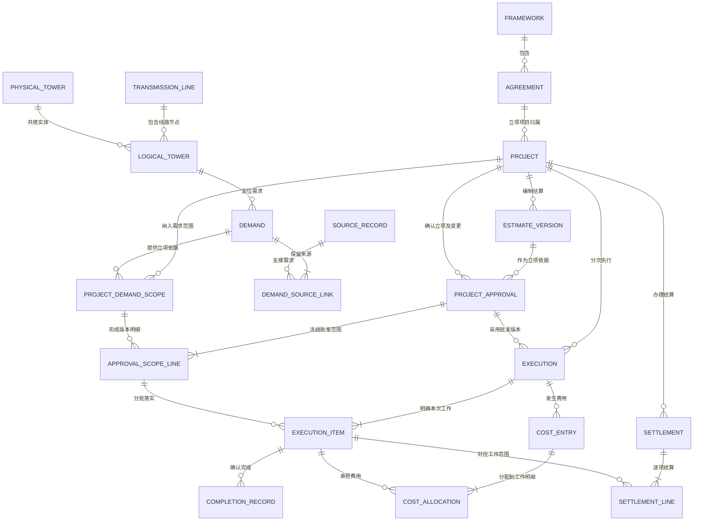
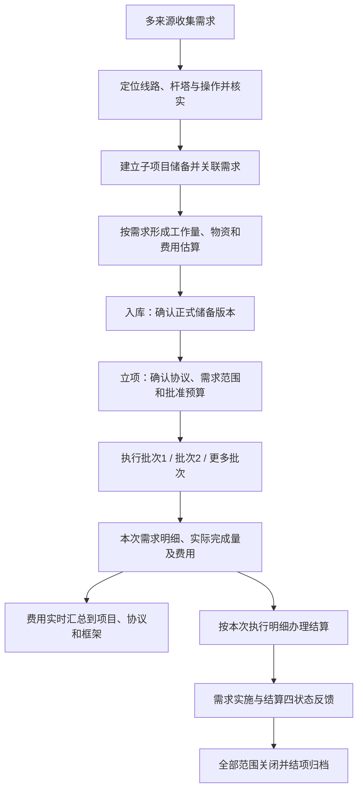
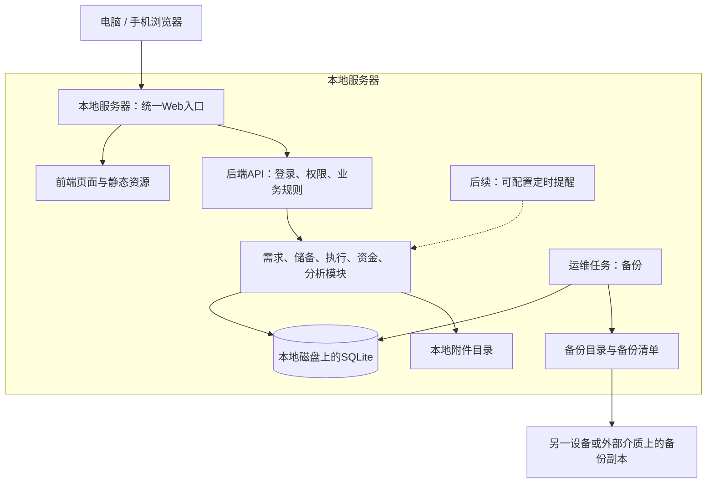

# 项目全流程管理系统功能设计文档

版本：V0.8，业务模型评审稿（支持需求批量创建及系统字典持续配置）  
日期：2026年10月29日  
用途：明确业务对象、全流程节点、估算与结算依据、费用归集及实时进度，作为原型和数据库设计依据。

> **后续正式裁决（2026-10-29）：** [六项开发约束](../decisions/设计裁决_2026-10-29_六项开发约束.md)已由用户逐项确认。本文未细化或与新裁决冲突之处以正式裁决为准。裁决中标注“待细化”的流程细则须另行审定。
> **最新架构裁决（2026-10-30）：** [四层管理及专业需求承接原则](../decisions/架构裁决_2026-10-30_四层管理与需求承接.md)已确认。管理视角为“年度框架→子项目→检修计划→专业需求”，资金视角为“年度框架→协行协议→子项目→检修计划→结算”。尚未逐处更名的“执行批次”沿用旧实现术语，改造时以本裁决为准。

## 1. 设计依据与已确定原则

### 1.1 本轮业务基线

以最新说明为准，统一以下关系及流程：

1. 年度框架直接管理子项目，子项目包含多个停电或不停电检修计划，检修计划承接专业需求明细；资金归属则为年度框架→协行协议→子项目→检修计划。子项目立项时只归属于其年度框架下的一个有效协行协议。
2. 需求从不同来源收集，正式需求明确到“某条线路、某基杆塔、某种操作”。
3. 子项目从储备阶段开始关联需求，依次经过“储备 → 入库 → 立项 → 执行”，同一子项目可执行多次。
4. 每次执行明确解决哪些需求、完成多少工作量、发生哪些费用；结算逐项对应执行及需求依据。
5. 每次有效费用确认后，按唯一归属实时汇总到子项目、执行协议和框架，无需在上级重复录账。
6. 建设重点是“立项有依据、费用估算准确、结算对应准确”。
7. 物理杆塔与逻辑杆塔是独立对象。同塔多回共享一个实体资产，每条线路上的命名分别由逻辑杆塔表示。
8. 需求支持一次选择多个线路杆塔、共用操作与来源、逐项预览后批量创建；单塔操作是需求核算粒度，不限制用户只能逐条录入。
9. 操作类型、单位、来源类型、优先级及类别字段等由系统管理维护，支持后续修改；保存配置版本及业务修订，不把选项写死在页面中。

本稿替换前稿中的“子项目可使用多个协议”和“一次项目级出库后执行”模型。项目入库表示进入正式储备库，立项表示获准实施；实物物资入库、发货与领用单独记录，不替代项目流程。

### 1.2 已确定的技术与范围

- 采用本地服务器 + SQLite + 本地附件存储，电脑或手机浏览器通过局域网访问。
- 以业务对象组织系统，Excel只承担导入、导出交换；直接录入与导入形成相同对象。
- 首期完成业务闭环、实时计算、预警展示、年度事项及状态查询。
- 自动定时提醒后续实现为可配置模块，首期不依赖提醒调度器。关闭提醒不能改变业务状态与资金计算。
- 本文是目标设计，未表示软件已实现；新的设计判断均以“建议”或明确的默认口径说明。

### 1.3 资料使用边界

旧项目 `/Users/zhangyuxi/Desktop/项目管理` 仅供参考，存在冲突时以本轮业务基线为准。[飞书参考表格](https://my.feishu.cn/base/DYzzbWX7jaJGMBs4O9EcKeoWnSg?table=tbl7m3uYL2WpnKv7&view=vewv4VnSS1)此前未能读取，实际字段、公式和视图尚未核对。“一年工作早知道”“项目储备类别”和代表性需求资料仍需核对有效版本，不据示例编造正式类别或日期。

## 2. 整体业务关系与流程

### 2.1 归属关系与追溯关系

**管理归属：**年度框架 → 子项目 → 检修计划（停电／不停电）→ 计划所承接的专业需求明细。

**资金归属：**年度框架 → 协行协议 → 子项目 → 检修计划 → 结算明细。

**业务与结算追溯：**需求及来源依据 → 子项目批准需求范围 → 检修计划工作明细 → 完成记录、费用明细 → 结算明细。原始专业需求保留独立稳定 ID，不因多个计划承接而复制。

两条关系交叉，但职责不同：前者决定费用归到哪里，后者说明为什么做、做了什么、花费多少及结算依据。



上图展示正式业务关系。建议储备草稿可暂未落实协议；在立项时必须确定唯一有效协议，此后按该固定链路归集费用，不能任意改挂。

### 2.2 项目流程



实施与结算是独立事实维度。立项后建立执行计划明细，既可记录后续实施，也可按实际业务登记明确标识的提前结算，保留“未实施已结算”状态，不用顺序流程伪造实施记录。

### 2.3 关键设计约束

- 子项目、执行批次各有稳定编号，从储备到归档沿用，不为每个阶段复制一套项目。
- 框架、协议、项目上的费用合计从有效明细计算；上级不能手填一笔“累计发生额”。
- 需求范围、估算计划、实施完成、费用发生和结算分别记录，并有明确关联。
- 已确认事实通过变更、冲销、撤销更正保留历史，不覆盖旧依据。
- 物资数量不代替需求完成量，结算金额不代替结算范围，付款不代替结算。
- 页面实时显示和定时主动提醒分开。费用确认、撤销后实时重算，不等待定时任务。

## 3. 角色、职责与业务确认

| 角色 | 主要职责 |
|---|---|
| 需求提出/核实人员 | 登记来源、定位线路杆塔、描述问题与操作、核实工作量 |
| 项目管理人员 | 组合需求、编制储备、入库、立项、组织执行、处理变更和结项 |
| 估算编制/核对人员 | 核定工作量、物资、施工方案、价格与取费依据，解释估算偏差 |
| 实施人员 | 本次执行计划、供应与领用、实际完成量、验收依据、费用原始资料 |
| 财务/结算人员 | 确认费用、核对协议归属、逐项结算、冲销更正及资金分析 |
| 管理者/只读人员 | 查看授权框架、协议、项目、进度和报表 |
| 系统管理员 | 账号、角色、数据范围、字典、字段、参数；后续维护提醒配置 |

允许兼任角色。权限覆盖列表、业务动作、附件与导出，按框架/协议/子项目限制数据范围；前端隐藏按钮不能代替后端授权。入库、立项、完成确认、费用确认和结算确认记录经办人、时间、依据和版本；具体多人审批层级待制度核对，不预设额外审批链。

## 4. 基础台账与需求定位

### 4.1 位置与操作台账

| 对象 | 核心关系及属性 |
|---|---|
| 电压等级 | 下设线路；使用统一字典 |
| 线路 | 唯一稳定线路ID、电压等级、名称及更名历史 |
| 逻辑杆塔（线路杆塔位置） | 属于一条线路，正式启用时引用一个物理塔；有独立ID、线路杆塔号、顺序和历史 |
| 物理杆塔 | 实际资产，保存坐标、塔型等公共属性；同塔多回的多个逻辑杆塔引用同一实体 |
| 操作类型 | 更换、加固、安装、拆除、修复等业务操作及适用单位、字段、验收要求 |
| 物资/施工项目/价格依据 | 标准编码、规格、单位、有效价格版本、适用条件及来源 |

正式需求关联一条线路上的一基杆塔位置及一种操作。电压等级从线路取得，杆塔必须属于该线路。线路或杆塔更名不改变需求位置身份。

原始来源若描述“某线路一段范围内开展若干操作”，先保留原文，再依据实际杆塔清单核实拆成多条需求，不自动猜测中间杆塔。整线、区段可作为来源范围和筛选条件，正式执行及结算仍需落到可确认的单塔操作明细。

### 4.2 可扩展字段

按操作类型、项目类别和流程阶段配置文本、数值、日期、单选、多选、成员、附件及关联对象字段，定义必填、选项、单位、校验和版本。例如更换绝缘子可记录相位、串位、原型号、目标型号；正式字段按业务资料核定。

字段变化不重新解释历史确认版本；需求类别、操作类型、项目储备大类是不同维度。

操作类型、单位、来源、优先级等业务字典由“系统管理”提供新增、修改名称/编码、排序、默认值、停用及重新启用。操作类型可配置适用对象、默认单位、工作量、完成标准和字段模板。台账型下拉引用基础台账对象，不另复制枚举。

字典采用稳定ID及版本历史。修改后新录入立即可用，已保存需求保留当时名称和采用版本，也可按草稿编辑或已确认需求修订流程更新；不因改名或停用丢失历史依据。停用项不供新提交，当前表单遇到配置失效须核对，不静默改选。

### 4.3 物理杆塔与逻辑杆塔的数据库关系

线路1:N逻辑杆塔，物理杆塔1:N逻辑杆塔；一个正式逻辑杆塔同时引用一条线路和一基实体，逻辑表表达线路与物理塔的多对多关系。

例如甲线#101、乙线#088、丙线#015分别是三个逻辑节点，但都可以引用同一个物理塔P001。三条线路可以有不同电压等级，物理塔不保存单一所属线路或电压等级。线路名称、电压等级归线路；线路杆塔号、回路位置和沿线顺序归逻辑塔；资产编号、塔型、坐标等归物理塔。

各表使用稳定ID，命名、编号和外部资产号不作为业务主键。逻辑表中的物理ID不能设唯一；显示重名、编号复用须按逻辑位置编码消歧，不按同号或相近坐标自动判同塔。沿线顺序独立保存，不能用杆塔编号替代真实顺序。

### 4.4 命名、实体关联和业务历史

线路更名、逻辑塔更名、逻辑与实体的关联变化分别保存有效期历史。当前值与历史在同一事务更新，区分关联纠错和真实换塔。单纯更名不换ID；实体更换但逻辑位置未变时，新建物理资产并保留旧实体和关联历史。

需求引用逻辑杆塔ID，另保存当时核实的物理塔ID、命名快照和关联时点；执行及结算引用批准范围并保存实际作业实体，后续改名、重绑不能静默改写历史。未核实实体可留草稿，正式启用必须有已确认实体。

### 4.5 共塔需求与费用去重

作业对象区分线路侧部件和物理塔公共资产。甲乙线各自绝缘子更换是独立工作；同一实体基础加固若为同一问题，应核实成一条公共实体作业需求，保留主逻辑位置并关联其他受影响线路，多个来源归同一需求。具体对象、部位及问题批次仍需核实，不凭同塔同操作自动合并。

共用实体作业工程量、发生费用和结算只记录一次，按线路展示需要时使用分摊。逻辑塔数量、物理资产数量和关联线路数分别统计。

详细字段、关系、命名及换塔规则见[线路与杆塔数据库设计](/Users/zhangyuxi/Desktop/sd_project/线路与杆塔_数据库设计.md)，核心DDL见[结构草案](/Users/zhangyuxi/Desktop/sd_project/线路与杆塔_核心表结构草案.sql)。两份均为设计稿，未建立正式业务数据库。

## 5. 多来源需求管理

### 5.1 需求的最小业务含义

一条需求表达：**在某条线路的某基杆塔，对某个对象执行某种操作，以解决一个明确问题。**

示例（合成）：110kV甲线#101塔，左相绝缘子串，更换1串，依据某次巡视发现的缺陷。

同塔的更换绝缘子、加固基础属于不同需求；同一操作针对不同对象时也应区分。需求可有工作数量，例如同塔同类操作2套，须明确对象或工作单元，便于分次执行和结算。

### 5.2 需求与来源分开保存

| 对象 | 保存内容 | 关系 |
|---|---|---|
| 来源记录 | 来源类型、提出人/单位、日期、原始描述、外部编号、证据附件 | 可为巡视、缺陷、专项排查、计划、上级要求或其他实际来源 |
| 需求 | 线路杆塔、操作、处理对象、工作量、完成标准、责任人、期望时间、有效状态 | 系统内唯一业务事项 |
| 需求来源关联 | 来源记录与需求的对应、核实意见 | 一个来源可拆多需求；同一需求可有多份来源依据 |
| 需求物资 | 当时已知型号、数量、单位和依据 | 一需求可有0至多条，不直接等同项目最终物资 |

重复上报同一未解决问题时，经核实将新来源关联到已有需求，不能重复增加待解决工作量。同位置、同操作仅是疑似重复条件，不设为永久唯一键；既有问题完成后再次发生，建立新需求并可关联前次事项。

Excel文件、工作表和行号只属于采用导入时的辅助来源信息。手工登记不需要伪造文件来源。

### 5.3 需求字段与维护

保留序号、电压等级、线路名称、杆段/杆塔、物资型号、物资数量等展示及交换字段；系统编号独立唯一。正式需求以单塔操作作为核算粒度，物资以子明细保存。

补充问题说明、操作类型、处理对象、工作数量与单位、完成标准、来源、核实状态、责任人和期望日期。资料不全可保存草稿；核实后才作为正式储备及立项依据。物资未明确时标为待明确，不把未知数量或价格填写为零。

需求池展示来源、待核实/有效/取消状态、关联项目、已纳入数量、未落实数量、实施及结算进度。需求内容变更保留历史，不能覆盖已入库、已立项及已执行版本。

### 5.4 需求录入表单与核实

采用“批量选择位置—共同工作内容—共同来源依据—补充资料—逐项预览”一页分区表单。用户可一次选择多个线路逻辑杆塔，填写共同操作、部位、每项工作量/单位、完成标准、问题说明和来源，再逐项修改差异或排除行。仅选1个位置时按同一规则创建单条。公共实体作业额外核对受影响逻辑线路范围。

电压等级、当前物理塔和共塔线路自动带出；需求标题建议自动组合，编号、登记人和登记时间由系统记录。附件、优先级、期望日期和已知物资允许后补；物资行一旦填写需校验名称/型号、正数数量与单位。需求阶段不要求填写框架、协议、项目或估算费用。

“保存草稿”允许缺项，“提交核实”校验必填并进入待核实。具备权限的人员确认位置/实体、操作范围、来源、重复事项及完成标准后，需求才成为有效立项依据；提交表单不自动等同核实确认。需求管理状态与实施/结算四状态分开保存。

### 5.5 批量创建的数量、来源和重复控制

支持逐基勾选、全选筛选结果、按真实台账顺序选杆段及跨线路追加；重叠选择按逻辑ID去重。每基数量与总量分别显示，共同默认值只作用于未单独调整的行。

例如选30基、每基安装2套防鸟装置，预览为30条独立需求、总工作量60套；每条均有自己的逻辑位置、对象和后续实施/结算状态。共有排查来源记录一份，分别关联各需求，不复制成30个独立排查事实。物资数量明确按每条需求或经核定分摊，不将整批总量重复复制。

共塔线路侧工作不合并；公共实体同一部位须人工确认是否同一作业，确认合并后保留相关逻辑位置，工程量只计一次。批次预检到行并在提交时重校验台账及配置，问题行不得被静默跳过；提交幂等，分片暂存统一发布，重试不重复生成需求。

具体字段、联动和页面验收见[需求录入交互设计稿](/Users/zhangyuxi/Desktop/sd_project/需求录入_交互设计稿.md)。

## 6. 项目储备、入库与立项依据

### 6.1 储备阶段就建立项目—需求关系

储备阶段建立一个子项目，选择拟解决的专业需求并明确各自的批准承接范围。**正常情况下，一条专业需求只由一个子项目承接**，但允许同一需求在该子项目的多个检修计划中分次实施，例如需求10套，子项目承接10套，两个停电检修计划各安排5套。跨子项目拆分属于待进一步裁决的例外，不能仅凭各项目承接数量总和不超标就自动批准。

项目需求关联至少保存：项目ID、需求ID、采用的需求版本、工作对象/范围、计划工作量及单位、剩余未纳入量、纳入原因和当前状态。该关联从储备延续到执行与结算，不在立项时重新建立一份无法对应的需求清单。

同一需求范围不能同时被多个有效立项项目重复承接；候选储备方案如重叠应明确为备选，立项时只允许确认选定方案。增加范围必须关联新增需求或已有需求的明确未覆盖部分，不能凭费用增加反向伪造工作内容。

### 6.2 需求形成估算与物资计划

按“需求 → 核定工作量 → 作业方案 → 物资及施工费用明细”编制估算：

| 明细 | 必备依据 | 计算要求 |
|---|---|---|
| 物资 | 对应需求范围、型号、单位、设计/核定数量、价格来源和日期 | 数量×单价，明确含税口径 |
| 施工/人工/机械 | 作业类型、工程量、适用定额或报价、作业条件 | 核定工程量×适用单价，避免与物资重复包含 |
| 其他直接费用 | 费用类别、计价方式及业务依据 | 按金额或明确的计价基数与费率计算 |
| 公共费用 | 费用用途、分摊基数、受益需求明细 | 确认分摊方式，分摊合计必须等于原费用 |

需求物资是编制参考，项目物资可核定、补充、增减及换型，并记录差异原因。合并相同物资用于采购/供应展示时，仍保留对应各需求的数量分解，不能合并后丢失施工及结算位置。

单价必须记录来源、适用时间、版本、税口径及证据；相似型号价格只能作为待核建议。缺价明细显示待估价及已知小计，不能形成看似完整的总预算。

### 6.3 各阶段分别确认什么

| 阶段 | 输入与条件 | 形成的不可覆盖依据 |
|---|---|---|
| 储备编制 | 关联需求、提出工作方案、明确工作量，允许价格待完善 | 编制草稿及修订记录 |
| 入库 | 至少有有效需求依据、明确范围、类别、初步估算及完整性说明 | 入库编号/日期、需求范围、估算与物资版本、核对人 |
| 立项 | 采用有效入库版本；确认唯一有效执行协议；范围、价格及费用依据核定，关键缺项已解决 | 立项编号/日期、采用的入库与估算版本、需求版本、批准预算、协议及额度版本、立项依据 |
| 执行 | 已立项，在批准需求范围及方案下安排本次工作 | 执行批次、工作明细、计划/实际记录 |
| 结项 | 需求范围已关闭或有正式取消/转移依据，费用和结算已核对 | 结项报告、差异说明及归档资料 |

建议储备时允许协议待落实，入库时展示拟归属，正式立项时必须绑定一个有效协议。是否要求入库前就落实协议可进一步核定，不改变正式子项目唯一归属。

立项有依据的具体表现：每条批准工作都能追溯到已核实需求及来源，每条预算都能追溯到工程量、物资、价格和计费依据。立项不能只填一个项目名称和总金额。

### 6.4 版本与变更

入库、立项保留各自事件及快照，同一项目ID贯穿全过程。储备修订不覆盖原入库版本；立项后的范围、型号、价格或预算变更形成变更单，说明原因、影响及新增/减少依据，确认后产生新有效版本。

新增需求先纳入项目的有效范围版本，再安排执行。缩减范围不得抹掉已经完成、发生费用或结算的事实；取消项目也需处理已发生费用。项目阶段不因后续补结算而回退为储备。

## 7. 同一项目多次执行

### 7.1 执行批次与需求明细

一次执行是一个项目内有明确时间、人员、工作范围及费用的业务批次，不建立新的子项目。

| 对象 | 主要字段 | 作用 |
|---|---|---|
| 执行批次 | 项目、批次号、计划/实际时间、负责人、施工单位、采用的立项/变更版本、状态 | 回答本次是谁、何时、依据哪个版本组织执行 |
| 执行需求明细 | 立项/变更范围明细、项目需求关联、本次工作对象、本次计划数量、单位、完成标准 | 回答本次准备解决哪些具体需求，锁定批准范围版本 |
| 实施/验收记录 | 执行需求明细、本次完成数量、日期、核实状态、证据 | 回答实际解决了多少；可多次登记 |
| 执行物资明细 | 物资计划来源、对应工作明细、计划领用/实际使用/退回数量 | 计划和实耗分别保存 |
| 费用明细及分摊 | 执行批次、费用性质、数量、单价、金额、凭证、受益工作明细 | 回答本次费用如何形成和归属 |

执行明细必须引用当前有效项目需求范围，不能只填一段自由文本或只挂项目总额。需要处理计划外需求时先办理项目范围变更，再安排执行。

### 7.2 分次解决与重复控制

同一专业需求允许在同一个子项目的多个检修计划中分次解决，例如需求10套、子项目批准10套，停电检修计划 M1 与 M2 分别安排5套。计划需求明细均引用同一项目批准需求范围，不增加新的专业需求记录；有效完成工作量与尚未结束计划的预留工作量合计不得超过批准范围。已结束计划的未完成部分释放后可由后续检修计划重新安排，并保留原计划及结批审计（C01）。

业务确认时同时检查项目范围、其他批次占用及需求剩余量，防止多人同时安排相同部分。返工是针对原完成事实的独立返工记录及费用，不重复增加原需求已解决数量；原验收撤销则重新计算未解决范围。

一次执行未成功解决需求但确实发生费用时，应允许按真实情况登记零完成量及费用原因，不以伪造完成量换取记账。取消尚未发生的计划可释放范围，已有完成或费用的批次不得直接删除。

### 7.3 物资与供应

物资上报、发货、到货、领用、退回与现场实施独立记录。对采用完整供应追踪的明细，累计到货≤发货≤上报≤有效计划量；实际领用和退料需与批次、物资及工作明细对应。

项目入库不增加物资库存，物资到货不自动认定需求完成。项目计划量、任务分配量和实际消耗分别保存；是否对接独立仓库库存系统列为后续范围。

## 8. 费用与结算逐项对应

### 8.1 执行费用发生

费用从执行批次的明细产生，至少记录费用类型、业务日期、工程量/物资数量、单位、单价、金额、税口径、凭证、确认状态及冲销关联。

直接费用归属对应执行需求明细；本批次共同费用采用分摊表，按经确认的工程量、直接费用或人工金额分摊。单条费用的分摊合计精确等于费用金额，舍入尾差明确落到一条分摊行，不能在多个需求上重复计算整笔费用。

草稿不计有效发生额，确认后立即影响项目、协议、框架；更正用调整/冲销并保留原记录。若实际费用超过批准预算，展示差异并按制度办理变更，不能为隐藏超预算而截断真实费用。

### 8.2 结算单头与结算明细

建议一张结算单归属一个子项目，可以覆盖该项目多个执行批次；一批执行也可分多次结算。这样既能合并办理，也能保持每项对应。

| 对象 | 内容与校验 |
|---|---|
| 结算单头 | 项目、结算编号、期间、单位、总额、状态、确认人、日期及附件；协议和框架从项目归属取得 |
| 结算明细 | 必须引用执行需求明细，注明结算对象/范围、工作量、单位、核定单价、金额、是否本范围最终结算 |
| 结算费用对应 | 将结算明细与费用发生明细关联，分别保存本次对应的发生费用份额、核定结算额、差额及是否最终核对；支持一笔费用分次结算及一行结算对应多条费用 |
| 结算依据 | 引用采用的立项/变更、执行记录、验收资料、价格依据和必要说明 |

结算费用对应关系采用金额分配，核定结算额合计与结算行一致；有效关联的发生费用份额不得重复占用同笔费用，累计不能超过该笔有效发生额。每笔分配只能引用同一项目和相容工作范围的费用，不允许跨项目、跨协议混挂。

结算额可以与发生费用或批准预算不同，差额要明确原因和核定依据。不得直接把发生费用加上结算额作为累计支出，也不能因为总额相等就视为结算范围正确。

例如，一笔发生费用3000元，本次最终核定2900元，保存“对应发生费用3000元、核定结算2900元、核减100元、该费用已最终核对”。这100元不是尚未结算费用。待结算费用按尚未最终核对的发生费用份额统计，不能直接用C－S代替；工作范围是否最终结算仍独立判断。

正常结算引用已确认完成/验收范围。保留明确标识的提前结算路径，引用已经立项并安排的执行需求明细和计价依据，记录原因；涉及的正式费用确认前可标记“费用待核对”，不能伪造实施或费用事实。补充事实后再完成费用对应核对；常规结算确认及最终结项不得保留无说明的未对应明细。

### 8.3 避免重复结算和错误覆盖

- 同一工作对象已最终结算后，不能再次正常办理全量结算；差额、返工或更正须引用原记录并说明类型。
- 中间付款、阶段款或部分结算，不自动产生整个需求的最终结算完成标记。
- 范围和金额分别校验：同一范围可能有多次支付，但最终完成数量只计算一次。
- 结算确认、范围覆盖及费用对应同时提交；撤销后重新计算未结算范围和金额，保留原依据。
- 已最终核对的发生费用如需更正，应同时明确关联结算的差额或撤销处理，不能单独冲销后留下无法解释的费用对应关系。
- 付款如需管理，建立独立付款明细关联结算，不把付款状态当成实施或结算状态。

### 8.4 需求状态与待结算清单

需求按其全部有效工作范围计算实施是否完成、是否已经最终结算：

| 全部实施完成 | 全部最终结算完成 | 反馈状态 |
|---|---|---|
| 是 | 是 | 已实施已结算 |
| 是 | 否 | 已实施未结算 |
| 否 | 是 | 未实施已结算 |
| 否 | 否 | 未实施未结算 |

同时显示计划工作量、有效完成量、最终结算覆盖量及待安排量。“未实施/未结算”表示未全部完成，不能掩盖部分进度。需求整体范围是分母，不以某个局部项目/批次范围代替。

首期在查询时生成“已实施但未最终结算”的范围清单，显示执行批次、责任人和实施日期；最终结算后相应范围退出，撤销后重新出现。后续结算提醒引用此清单及可配置起算规则。

## 9. 框架、协议、项目的资金及进度

### 9.1 唯一归属与各类金额

框架有总体额度F；每个协议有额度A和有效期；一个已立项子项目只属于一个协议，项目批准预算B来自有效立项/变更版本。费用和结算沿“执行 → 项目 → 协议 → 框架”自动归集，不再按多个协议人为拆分同一项目。

| 金额 | 来源及用途 |
|---|---|
| 储备估算E | 入库/储备版本，用于储备价值和拟立项测算，不自动当作已发生费用 |
| 批准预算B | 立项及已确认变更的当前有效预算，历史预算不重复求和 |
| 预算发生O | 如制度需要单独登记，保留独立的已确认预算发生事实，用于原需求中的月度/季度预算发生分析 |
| 费用发生C | 本项目各执行批次确认的实际费用净额；草稿不计，冲销/调整按有效净额计算 |
| 结算金额S | 已确认结算明细净额，与费用发生分开展示 |
| 付款P | 如启用付款管理，按独立付款记录计算，不自动等于结算金额 |

协议额度是授权额度，如“预支”还包含实际预付款则单独管理付款事实。B、O、C、S不能相加；登记实际费用不默认为预算发生，确认结算也不自动复制实际费用。

立项前协议必须有效。储备可调整拟归属；立项及已有费用后禁止普通编辑改挂协议。确需调转应有明确的变更方案处理原协议历史及后续范围，不能把历史费用静默搬到另一协议。

### 9.2 实时汇总规则

```text
项目发生费用 C_project = 本项目所有有效执行费用发生净额之和
协议发生费用 C_agreement = 所属项目发生费用之和
框架发生费用 C_framework = 所属协议发生费用之和
结算金额和预算发生金额按各自事实以同样路径独立汇总
```

确认/冲销后，在同一业务提交完成后的查询中即可看到结果，不等待定时扫描。首期可直接查询有效明细并按层级汇总，避免维护多份可手改的总额；需要性能汇总表时，其更新必须与事实事务一致，并可从明细重建。

完成记录、费用和结算分别先聚合再关联，避免一笔费用因关联了多条完成记录或结算行被重复乘算。多张汇总卡片使用同一统计截止点和一致读视图。

### 9.3 “进度”至少区分三个维度

| 维度 | 子项目 | 执行协议 | 框架 |
|---|---|---|---|
| 工作完成 | 有效完成需求数/批准需求数；另列工作量明细 | 汇总所辖项目已确认范围，明确是否按需求计数 | 同口径汇总，不重复计跨项目分配需求 |
| 发生费用进度 | C÷批准预算B | C÷协议额度A | C÷框架额度F |
| 结算费用进度 | S÷批准预算B，另列最终结算范围 | S÷协议额度A，另列待核发生费用/范围 | S÷框架额度F，另列待核发生费用/范围 |
| 年度预算发生进度 | O÷本项目年度发生目标 | O÷协议年度发生目标 | O÷框架年度发生目标 |

不同操作和单位不直接相加成统一工程量；可以展示按需求条数计算的完成率，或核定权重后计算，必须标注口径。最终结算范围完成率与结算金额比例不同；金额未达到预算并不表示尚未结算完成。

费用使用率达到100%或超过预算时如实展示，不截为100%；分母为零显示待配置。取消、关闭、跨年等范围使用明确口径，全周期框架预算合计不能因为项目结项就丢掉该项目预算。

### 9.4 示例：一次登记如何贯通全链路

以下为合成数据，仅说明关系：

- 框架F总额100万元，协议A属于F，额度30万元。
- 子项目P属于A，储备时关联D1、D2、D3：分别为甲线#101更换、#102更换、#103加固，各1项。
- 估算分别为3000元、3000元、6000元，入库后立项批准预算12000元。
- 第一次执行E1解决D1、D2，各发生费用3000元，总费用6000元；逐项最终结算各2900元，结算合计5800元，说明核减原因。
- 第二次执行E2解决D3，发生费用4200元，尚未结算。

结果：P费用发生10200元、结算5800元，发生费用进度85%；协议A发生费用进度3.4%；框架F发生费用进度1.02%。D1、D2为已实施已结算，D3为已实施未结算。结算额低于对应发生费用，并不妨碍经确认范围已最终结算；差额可以逐行核对。

## 10. 分析、预警与后续可配置提醒

### 10.1 首期预警展示

费用确认和页面查询时实时计算，不依赖定时器。建议按执行费用发生净额C展示额度使用，同时保留预算发生O口径供制度选择；正式额度预警口径需核定并在界面固定标注。

| 规则 | 默认条件 | 展示内容 |
|---|---|---|
| 协议额度使用 | 使用额÷协议额度≥90% | 使用额、余额、涉及子项目及执行费用 |
| 框架额度使用 | 使用额÷框架额度≥80% | 协议贡献、当前余额及费用明细 |
| 项目预算超框架 | 当前有效批准预算合计>框架总额 | 超额额及项目；储备拟立项估算另列，不混入正式发生 |
| 预算发生滞后 | 同期O÷同期计划<80%（建议默认） | 缺口、主要滞后子项目、已记录原因 |
| 项目估算/执行偏差 | 比较批准预算、执行费用及结算 | 分需求、分物资/施工项解释量差、价差、变更及核减 |

精确比较阈值，不能按界面舍入百分比判断。默认协议恰好90%、框架恰好80%触发；预算合计等于框架不触发超额；分母未知/为零标明无法计算。

预警默认是提示，不能因此拒绝真实费用记录。项目未立项、范围越界、协议归属不符、重复结算等属于业务校验错误，不能仅作为可忽略提示。

### 10.2 月度和季度分析

季度新增目标默认各25%，季末累计25%、50%、75%、100%；跨年度框架和协议单独设置年度目标。自定义月计划核对季度及年度合计，项目按实际实施安排分解，不能要求所有项目同时完成同一比例。

月报区分预算发生、实际费用和结算；记录对象、截止点、口径、目标与规则版本。正式月报按已结束月份形成，当月标记进行中，不用整月目标判月初滞后。未开始季度不提前考核。

按“累计计划－累计实际”的正缺口识别滞后子项目，列未分解计划、主要缺口及有记录支持的原因；协议和框架可以逐级下钻到执行明细。不能凭资金滞后自动推断实施人员工作原因。

### 10.3 估算—发生—结算对比

对同一需求范围、相同费用项比较立项工程量及单价、实际工作量及发生费用、核定结算量价。新增需求、范围变更、物资换型、量差、价差、公共费用及结算核减分别说明，不用“总额差异”代替具体原因。

保存分析和月报快照。补录、更正、预算变更后可生成修订版，不能覆盖旧报表。首期手工生成和导出，定时摘要后续接入。

### 10.4 自动提醒生命周期（后续阶段）

本节描述后续提醒事件及处理流程。首期页面仅根据当前事实显示预警和恢复结果，无需实现事件推送、已读状态或提醒处理中心。

预警记录包括规则、对象、统计时点、分子/分母、阈值、触发原因、责任人、严重程度、处理状态、处理意见和恢复时间。

首次达到阈值提醒；持续未解决以摘要跟踪，避免反复刷屏。金额回落、额度调整或冲销使条件不再满足时标记恢复；再次越线产生新事件。用户“已读”或“已处理”不会修改实际资金事实。

### 10.5 可配置提醒规则（后续阶段）

提醒作为独立可启用模块，不把提醒时间、通知对象或发送频率散写在各业务功能中。后续实现规则配置界面、规则评估、调度执行和通知记录；首期业务日期、责任人及分析参数为其提供数据基础。

| 配置项 | 配置内容 |
|---|---|
| 启用与适用范围 | 模块总开关、规则开关，适用业务类型、项目类别、框架或具体项目 |
| 条件与阈值 | 协议使用率、框架使用率、预算超额、进度滞后、未结算范围或年度事项；引用统一统计口径和参数版本 |
| 起算与提前量 | 首次实施、全部实施、验收或明确事项日期；提前几天、到期当天及逾期几天提醒；月份精度使用对应月份规则 |
| 检查与发送时间 | 检查频率、每日发送时段、工作日规则及时区，默认北京时间；仅在配置需要时启用相应选项 |
| 接收对象 | 项目负责人、协议负责人、实施人员、财务角色或指定成员，按角色和业务数据范围解析 |
| 渠道与内容 | 站内通知及可选外部渠道、消息模板、标题、业务链接；只可选择已配置且可用的渠道 |
| 重复与摘要 | 仅首次、持续未解决时按间隔重复、每日摘要、暂停时段、恢复及再次触发策略 |
| 完成与停止 | 最终结算、事项完成、风险恢复、取消、延期或规则停用后的关闭和重新评估规则 |
| 生效与历史 | 生效时间、规则版本、修改人、原因及历史；按全局→类别→具体对象继承，具体层覆盖同项配置并展示最终生效值 |

模块默认关闭，业务人员配置并启用后才开始生成和投递提醒。关闭提醒不改变业务状态、金额计算、数据校验或页面预警；修改阈值需有权限并留版本，不能无提示改写旧月报。停用规则后未发送通知取消或暂停，已发送记录保留；重新启用时按配置补查当前未解决事项，不补发全部过期消息。

启用前支持预览：显示命中对象、计算依据、预计提醒时点和接收人，不发送消息。规则评估、事件生成和发送分别记录状态，重复扫描和重启不能重复创建同一提醒；失败按配置重试。单项规则应使用预定义条件及类型化参数，不要求用户编写脚本。

配置示例：对某项目类别启用结算提醒，起算点选择“全部实施完成”，期限设30天，提前3天和到期当天提醒项目负责人及财务，逾期后每7天重复，最终结算后停止。此配置不改变需求四状态的计算依据。

## 11. 年度关键事项

首期维护“一年工作早知道”对应的年度事项、依据、负责人、关联范围、日期精度、完成标准、延期及完成情况，提供本月、到期、逾期筛选。事项可直接维护或导入，原文/附件作为业务依据。

具体日期按实际日期展示；只有月份时保留月精度，过月未完成可显示逾期；日期未知列待补，不能编造某个日。跨年复制重新核对日期和责任人。

后续提醒模块配置提前量、起算点、接收人及重复周期；事项完成后停止提醒。首期不要求主动投递。

## 12. 项目储备类别与金额占比

按“项目储备类别”有效资料维护大类字典及映射。需求类别、操作类型和储备大类分别维护，混合项目按费用明细明确分类/分摊，每笔金额只计一次。

建议正式现状储备统计默认采用：**已入库、尚未立项、未取消项目的最近有效入库/变更版本**。储备草稿与已立项项目分别查看，不混进正式储备库；立项时退出当前储备统计，历史快照仍保留。此口径依据本轮入库、立项流程提出，需核对实际储备统计制度。

建议主图按项目完整估算金额（物资、施工及其他）分类，以反映拟立项资金需求；可切换物资金额，但标题、范围和分母明确区分。公共费用不能在多个类别重复计入，待分类金额单列。

```text
已知储备估算总额 = 各大类已分摊金额之和 + 未分类已知金额
某大类占比 = 该大类金额 / 同口径已知储备估算总额
```

未知价格不当零价，单列缺价明细及受影响项目，图表注明估算覆盖情况；总额为零不展示无意义占比。图表、列表、项目详情、导出使用相同快照和分类版本，可下钻到项目、需求、量价与依据。

## 13. 页面与业务操作

| 页面 | 核心内容 |
|---|---|
| 工作台 | 待核实需求、待完善储备、待立项项目、待结算范围、额度及进度预警 |
| 需求中心 | 多来源、单塔操作、物资、核实、项目覆盖、四状态及证据链 |
| 框架/协议中心 | 严格树形归属、额度、预算、发生、结算和工作进度，下钻到子项目 |
| 项目中心 | 储备编制、入库、立项、版本变更、执行批次、费用结算及结项 |
| 本次执行详情 | 需求工作明细、完成/验收、物资实耗、费用及结算对应 |
| 结算工作台 | 选择项目与执行需求明细、核定量价、费用对应、差异说明、确认与撤销 |
| 分析中心 | 月报季度、估算偏差、费用发生、结算、滞后与储备分类 |
| 年度事项 | 依据、日期、责任人、延期和完成状态 |
| 系统管理/基础设置 | 线路杆塔及物资台账；操作、单位、来源、优先级等字典及版本；类别字段、价格、成员权限；提醒配置后续提供 |

项目详情突出“立项依据、量价估算、执行结果、费用发生、结算对应”五个区域。费用只在明细登记一次，上层卡片提供下钻。Excel位于相应页面的导入、导出工具中。

## 14. 数据设计与本地服务器架构

### 14.1 建议数据对象及主外键

以下为逻辑数据关系，尚未执行建表。主键使用稳定系统ID，名称和外部序号不作为关联身份。

| 表/对象 | 关键外键和字段 | 核心约束 |
|---|---|---|
| frameworks 框架 | id、总额度、期间、年度目标、版本 | 一对多协议 |
| agreements 执行协议 | framework_id、额度、有效期、版本 | 只属于一个框架 |
| projects 子项目 | agreement_id、阶段、当前入库/立项版本 | 储备可待匹配；立项后协议必填且唯一，框架从协议派生 |
| voltage_levels / transmission_lines | 电压等级、线路稳定ID、编码、当前名称、状态 | 线路属于一个电压等级，名称不充当身份 |
| physical_towers 物理杆塔 | 实体ID、系统编码、资产编号、塔型、坐标、状态 | 一基实体一条记录，不绑定单一线路或电压等级 |
| logical_towers 逻辑杆塔 | line_id、physical_tower_id、线路杆塔号、sort_rank、状态 | 多条逻辑记录可引用同一物理塔，正式启用必须有关联实体 |
| 线路/逻辑名称历史、实体关联历史 | 稳定ID、名称或实体、有效起止、修改人、原因 | 历史不被改名和重绑覆盖，当前与历史同事务维护 |
| source_records 来源 | 类型、原文、提出人、日期、证据 | 来源是业务依据，文件信息可选 |
| demands 需求 | line_position_id、observed_physical_tower_id、work_target_type、操作、对象、工作量、命名快照 | line_position_id引用logical_towers.id；当时核实实体与当前实体关联分别追溯 |
| demand_sources 需求来源 | demand_id、source_id、核实意见 | 多对多，组合关系不能重复 |
| demand_creation_batches / demand_creation_rows 批量创建 | 批次共同输入、稳定行键、位置、差异、校验结果、最终需求ID | 辅助记录本次创建，可恢复/幂等；不增加项目业务层级 |
| demand_related_logical_towers 受影响线路位置 | demand_id、logical_tower_id | 公共实体作业保留主逻辑定位，可关联其他受影响线路，不复制工程量及费用 |
| demand_materials 需求物资 | demand_id、物资、数量、单位 | 与项目物资独立 |
| project_demand_scopes 项目需求范围 | project_id、demand_id、需求版本、对象/范围、核定数量 | 已确认承接范围不能重复或超过需求有效范围 |
| estimate_versions 估算版本 | project_id、状态、版本、依据 | 草稿与确认版本区分 |
| estimate_items 估算项 | estimate_version_id、费用类型、量价税、依据 | 保留工程量、价格及计费依据 |
| estimate_allocations 估算分配 | estimate_item_id、project_demand_scope_id、分配量/金额 | 直接项及公共项明确对应需求，同口径分配金额守恒 |
| project_materials / material_allocations | 项目/计划版本、标准物资、数量；关联项目需求范围的数量分解 | 合并展示不丢失来源和位置 |
| project_stage_events 阶段事件 | project_id、事件类型、时间、人员、引用版本、附件 | 入库、立项、变更、结项各自留痕 |
| project_approvals 立项/变更版本 | project_id、采用估算、需求范围快照、协议版本、批准预算 | 批准预算仅取当前有效版本，旧版可追溯 |
| approval_scope_lines 批准范围明细 | approval_id、project_demand_scope_id、需求版本、对象、批准量及单位 | 冻结本版范围，不原地改写；变更产生新版本明细 |
| executions 执行批次 | project_id、采用立项版本、批次号、时间、负责人 | 已立项项目才可建立 |
| execution_items 执行需求明细 | execution_id、approval_scope_line_id、本次对象/计划量 | 所引用范围与批次属于同一项目及采用的批准版本 |
| completion_records 完成记录 | execution_item_id、对象/完成量、日期、确认状态、证据 | 不重复完成同一对象，累计不得超范围 |
| execution_materials / supply_events | execution_id、计划来源、工作明细、供应及实耗记录 | 数量与阶段独立核对 |
| financial_entries 资金事实 | project_id、execution_id、类型、业务日、金额、确认状态、冲销关联 | 预算发生与实际费用类型分开，实际费用必须归属具体批次，项目归属一致 |
| cost_allocations 费用分摊 | financial_entry_id、execution_item_id、分摊金额 | 同批次/同项目，分摊合计等于该费用 |
| settlements 结算单 | project_id、编号、日期、状态 | 一单一项目，可含多执行批次 |
| settlement_lines 结算行 | settlement_id、execution_item_id、范围、量价金额、最终标记 | 同项目，明确结算范围，最终覆盖不能重复 |
| settlement_cost_links 结算费用对应 | settlement_line_id、financial_entry_id、发生费用份额、核定结算额、差异说明、最终核对状态 | 费用份额不重复，核定结算额与结算行对账；提前结算待核费用单独标明 |
| source_attachments / attachments | 所属对象、文件键、校验信息、上传人 | 业务对象授权读取，不开放数据目录 |
| monthly_plans / report_snapshots | 对象、期间、口径、规则及数据版本 | 月报历史不被当前规则覆盖 |
| categories / price_versions / field_templates | 类别、价格、字段及有效版本 | 历史采用版本可追溯 |
| dictionary_types / dictionary_items / item_versions | 字典类别、稳定选项ID、编码、显示名、排序、启停、当前及历史版本 | 支持管理员持续维护，引用ID与快照，不依赖名称作主键 |
| operation_profiles / profile_versions | 操作选项ID、适用对象、默认单位及量、完成标准、字段规则、版本 | 修改配置不静默覆盖旧需求；新提交校验当前可用性 |
| annual_items / members / audit_events | 事项、人员范围、操作前后值及原因 | 业务授权与确认留痕 |

后续再增加提醒规则、调度状态、提醒事件与通知记录。文件导入批次、映射和来源行是交换辅助对象，不加入框架—协议—项目的业务层级。

### 14.2 必须由后端保障的不变量

1. 项目协议属于唯一框架，执行及其需求范围属于同一项目，费用与结算不能跨项目错误引用。
2. 物资计划、范围承接、完成及结算覆盖分别校验；已确认事实不会因删除计划而消失。
3. 金额为整数分，数量和单价采用定点精度；明细逐行舍入再汇总，空值不当零。
4. 费用确认/冲销、分摊、审计在SQLite同一事务完成；并发版本检查和幂等重放保证不重复入账。
5. 结算确认及范围覆盖一致提交；检查最终范围、费用对应与差异说明，不能只校验总额。
6. 项目/协议/框架当前进度从有效事实计算，首期不需要定时任务；报表另保存截止点及快照。
7. 直接录入、Excel导入和导出使用一致权限及对象模型；计算状态不能被导入覆盖。
8. 确认版本不硬删除，变更需说明；台账更名或停用不损害历史依据，附件与主记录保持关联。

### 14.3 通用数据交换能力（Excel导入、导出）

业务页面按需要提供导入、导出工具，需求必须支持这两项能力。其他对象是否提供交换入口，依据其业务用途配置；不为Excel建立独立业务流程。

**导入：**支持模板下载、多文件/多工作表、字段映射、数据预览、错误定位、疑似重复核对及确认写入。Excel表头和行先转换为目标业务对象，再使用与直接录入一致的权限、字段校验和确认规则。同一需求的多行物资按稳定需求编号归集，无可靠标识时不能仅凭序号或位置自动合并。

导入已有对象时按系统编号或明确外部业务编号提出更新，展示变更及影响后确认。保留文件、工作表、行号等辅助追溯信息；重复提交同一导入操作不重复写入，失败或中断可重试，不产生半批正式记录。导入不能绕过入库、立项、实施或资金记录的专门业务动作。

**导出：**支持当前筛选结果及选定业务明细，明确导出时点、字段、金额单位和统计口径；需求导出包含基础字段，可按需附带物资子明细、关联项目、四状态和进度。明确区分便于查看的报表与可重新导入的交换模板，不能将计算结果列当作可回写的业务事实。

Excel的单元格布局、工作表结构和行号不决定系统业务对象的层级、关系或唯一身份。需求、项目和物资的一对多、多对多关系由业务模型定义，导入与导出负责转换表达。

### 14.4 本地服务器整体架构

采用浏览器访问的单体应用，前端界面与后端接口部署在同一台本地服务器，业务内部按模块分层。运维备份任务按需运行，自动定时提醒作为后续可配置模块接入。



| 层次 | 部署与职责 |
|---|---|
| 访问层 | 默认通过局域网地址或内部域名访问；仅本机使用时可通过localhost访问 |
| 前端 | 提供业务表单、列表、图表及导入导出界面，静态资源随应用本地部署 |
| 应用后端 | 统一执行身份认证、数据权限、业务校验、业务动作、金额计算和查询 |
| 业务模块 | 需求、储备、项目执行、框架协议、预算费用、结算、分析提醒按职责组织，使用统一业务对象 |
| 数据访问层 | 统一封装SQLite事务、查询、索引、并发控制和数据库版本管理 |
| 文件存储 | 本地目录保存附件、临时交换文件、生成报表和备份；文件访问由后端鉴权 |
| 运维任务 | 执行备份等维护操作，与业务提醒模块独立 |
| 提醒调度（后续） | 启用后按配置执行提醒扫描、主动通知、摘要和重试，不是首期运行依赖 |

前端与API使用同一访问入口。首期按单台服务器、单个应用实例设计；用户通过API共享集中数据，不在各自电脑分别维护数据库，也不直接打开共享SQLite文件。

前端建议复用旧项目的Vue + TypeScript，后端建议使用Node.js + TypeScript并参考旧项目已有的Node运行时；具体库及版本在实施时锁定。数据库和本地部署方式已经确定，不因这些实现选择重新悬置。

### 14.5 SQLite存储与事务设计

1. 业务数据库文件放在服务器本地磁盘的专用数据目录，由应用服务账号访问；不放在网络共享盘或自动同步目录中作为运行数据库。
2. 启用外键校验，按需求筛选、项目关联、业务月份和流水建立索引；业务数据、权限及审计统一纳入数据库管理。后续启用提醒时再增加相应规则、事件和到期待办索引。
3. 采用WAL模式支持读取与写入并行；写事务仍串行执行，采用短事务、锁等待超时和有界重试，避免长时间占用写锁。WAL对同机运行及网络文件系统的约束见[SQLite官方说明](https://sqlite.org/wal.html)。
4. 预算确认、资金流水、费用明细分摊、审计和相关业务记录在同一数据库事务中提交；任一环节失败全部回滚，不能留下半笔账。
5. 关键业务对象保留版本号，更新时检查版本；结合幂等键，保证重复提交和并发操作不造成金额、数量重复累计。
6. 大批导入分批暂存、校验后确认生效，正式查询不读取半完成批次；耗时解析、报表生成和文件操作放在写事务之外。
7. 金额、数量及比例沿用本文定点精度约定。正式发布前固定SQLite及驱动版本，并验证事务、并发、断电重启和备份恢复行为。
8. 数据库结构变更有版本记录。应用升级先校验数据库版本并备份，再执行经验证的升级步骤；不能在启动失败时自动清空业务数据库。

### 14.6 本地文件、后台任务与服务运行

**文件管理：**数据库保存附件归属、存储键、原文件名、大小和校验信息，附件内容保存在本地文件目录。数据库目录、附件目录、备份目录和日志目录与应用程序目录分开，更新程序不覆盖业务数据。临时导入导出文件设清理期限；正式附件按业务记录保留。附件不能通过猜测文件路径绕过权限下载。

**后续提醒调度：**启用模块后，将规则、执行进度、下次执行时间和幂等标识保存在SQLite。服务启动后恢复未完成任务，按配置补查停机期间错过且仍有处理价值的节点；已完成事项不提醒，同一事件不重复生成。定时器只负责唤醒任务，不能仅依赖进程内存保存计划。首期无需部署该调度器。

**运行保障：**应用以系统服务或受管理的进程运行，支持开机启动、异常重启、日志记录和健康检查；安装方式根据服务器操作系统选择。后续启用提醒时，关闭用户浏览器不影响服务端提醒，停机恢复后的补查遵循配置策略；该行为在提醒模块交付时验收。

**访问与账号：**账号、角色和业务范围由本地应用管理；局域网访问同样执行登录和后端权限校验。正式多人访问配置HTTPS。核心业务页面、静态资源和计算逻辑随应用本地提供；断开互联网但保留局域网时仍可运行，后续外部通知单独显示投递状态。局域网以外访问方式按实际需要另行配置。

### 14.7 备份、恢复与运维验收

备份对象包括SQLite数据库、正式附件、文件清单及恢复所需配置，标明应用版本、数据库版本、备份时间和校验信息。敏感配置受控保存，不能出现在普通业务导出中。

- **备份生成：**使用SQLite支持的一致性备份方式生成数据库备份，例如驱动提供的Online Backup API；不在应用持续写入时仅复制主数据库文件作为完整备份。数据库备份方式依据[SQLite官方备份文档](https://sqlite.org/backup.html)。
- **附件一致性：**首期完整备份采用短时维护窗口，暂停业务写入及附件增删，完成数据库快照和对应附件备份、核对清单后恢复写入；备份失败记录结果并告警，不将不完整备份标记为成功。
- **执行计划：**建议每天北京时间03:00自动备份，也可手工触发；建议保留最近7份日备份和3份月备份，实际时间、保留周期和容量在实施前确定。
- **副本位置：**服务器内保留便于恢复的副本，同时将成功备份复制到另一设备或外部介质；本机单份备份不能覆盖整机或磁盘故障场景。
- **恢复流程：**先在独立目录恢复并检查数据库完整性、关键业务金额、对象数量和附件校验；通过后在维护窗口切换，保留切换前数据及操作记录。恢复后要求重新登录。
- **日常运维：**显示最近成功备份、备份失败、任务失败、磁盘余量和服务健康状态。升级前备份，明确程序与数据版本的兼容及回退步骤。

定时备份属于数据保护运维能力，与本次延后的业务定时提醒独立；备份失败首期记录并在运维页面展示，主动通知待后续提醒模块启用。

备份恢复、异常重启和本地并发场景必须在目标服务器上实际验证。可接受的数据丢失时间、恢复时长和备份副本位置作为实施参数核定，不能仅以“已生成备份文件”代替恢复成功。

## 15. 首期范围与验收

### 15.1 开发与交付顺序

| 顺序 | 首期交付 |
|---|---|
| 1 | 本地服务及SQLite、账号权限、线路杆塔/操作台账、多来源需求及核实 |
| 2 | 项目需求范围、物资与费用估算、入库版本、唯一协议归属及立项 |
| 3 | 多次执行、需求工作明细、完成/验收、供应实耗及费用确认 |
| 4 | 明细结算、费用对应、差异核对、四状态及结项 |
| 5 | 实时框架/协议/项目进度、月季分析、储备结构及年度事项 |
| 6 | Excel交换、审计、附件、备份恢复和真实样例全链路对账 |

需求交换随需求功能交付。定时备份与业务提醒独立。自动定时提醒、配置界面、通知及重试列入后续阶段；首期不制作占位提醒中心。

### 15.2 首期关键验收场景

| 编号 | 场景 | 验收要求 |
|---|---|---|
| A01 | 框架—协议—项目严格归属 | 子项目只能通过唯一协议归到框架，禁止跨协议重复归集 |
| A02 | 不同来源重复提出同一问题 | 多依据归同一核实需求，工作量不翻倍；复发问题可新建 |
| A03 | 来源描述区段或多操作 | 核实拆成线路杆塔操作需求，保留全部来源，不猜测杆塔 |
| A04 | 储备开始关联需求 | 从储备到立项沿用同一范围关系，可看未纳入量 |
| A05 | 入库与立项 | 分别保存事件、版本和依据；未立项不得开始正式执行 |
| A06 | 关键估价缺项 | 缺价标未知，不能当零价形成完整批准预算 |
| A07 | 范围和价格变更 | 有原因、差异和新版本，原入库/立项/执行依据仍可复核 |
| A08 | 一个需求跨项目拆分 | 范围不重叠；候选重叠方案不能重复立项占用 |
| A09 | 一个项目分多次执行 | 各自需求明细、工作量、物资、费用和结算明确 |
| A10 | 并发安排和确认同一范围 | 不超分配、不重复计完成量；返工不额外完成原需求 |
| A11 | 未成功实施但有费用 | 零完成量与真实费用均可保留，有原因，不伪造实施 |
| A12 | 本次直接及公共费用 | 每笔费用只计一次，分摊守恒，可追溯受益需求 |
| A13 | 费用确认与冲销 | 提交后立即更新项目、协议和框架；原账与冲销可追溯 |
| A14 | 汇总关联多行完成/结算 | 金额不因多表关联成倍扩大，报表及下钻明细可对账 |
| A15 | 一张结算单覆盖多执行 | 限同一项目，每行对应具体执行需求及费用 |
| A16 | 分次结算和最终结算 | 已最终覆盖范围不重复结算，付款不能代替最终覆盖 |
| A17 | 发生额与结算额不同 | 差异有依据，两个口径独立，不相加；已核减并最终核对的差额不误算为待结算费用 |
| A18 | 提前结算 | 引用已安排范围，明确性质及待核费用，不伪造完成和费用 |
| A19 | 四状态与部分工作量 | 全需求范围是分母，局部完成不当整体完成；撤销后重算 |
| A20 | 三层资金与工作进度 | 分母及范围明确，发生、结算、预算发生分别展示 |
| A21 | 90%、80%及预算超额 | 真比例触发，超额费用不截断；预算版本不重复累计 |
| A22 | 月季进度与滞后 | 25%季度目标、跨年目标、未开始期间及缺口项目正确 |
| A23 | 正式储备与分类 | 入库未立项口径明确，立项退出，未分类/未知价格独立展示 |
| A24 | 手工和Excel交换 | 同一业务规则，编号匹配更新，来源可追溯，重复提交不重复写入 |
| A25 | 本地运行与权限 | 局域网可用，集中SQLite，详情、附件和导出无越权 |
| A26 | 恢复与全链路对账 | 数据库、附件、金额和范围能在隔离恢复后核对 |
| A27 | 年度事项 | 日期精度真实，完成延期后更新状态，不要求主动通知 |
| A28 | 同塔多回及不同电压共塔 | 一条实体、多条线路逻辑记录；公共属性共享，线路命名和电压各自正确 |
| A29 | 逻辑塔重名、更名及调序 | 使用稳定ID及顺序，名称匹配歧义提示核实；旧需求位置不变 |
| A30 | 实体关联纠错及实际换塔 | 保留前后实体和有效历史，执行/结算仍能定位当时资产 |
| A31 | 共塔公共作业与线路侧作业 | 公共同一问题只计一次工程量和费用，独立线路侧工作不误合并或自动完成 |
| A32 | 草稿、外键、状态与历史当前记录 | 正式启用缺实体被拒绝，非法关联不成立，当前历史不重复；业务层另校验有效期和一致性 |
| A33 | 批量勾选、杆段、筛选和跨线路 | 按真实台账节点创建，重叠去重，切换线路保留选择，逐基状态独立 |
| A34 | 每基数量、逐项差异、共同来源及重试 | 总量正确，公共值不覆盖差异，共有来源正确关联；重复提交不重复写入 |
| A35 | 系统字典新增修改排序及默认值 | 操作、单位、来源、优先级等维护后生效，使用稳定ID和模板版本 |
| A36 | 选项停用、历史显示及需求修订 | 停用不静默替换或破坏历史，可重新启用；旧需求可通过编辑/修订更新并保留依据 |

后续提醒另验收：规则配置与预览、启停及继承、按时扫描、重启补查、幂等及重试、完成后停止，不作为上述首期门槛。

## 16. 建议默认值及待核定事项

最新明确的层级、单塔操作需求、储备—入库—立项—多执行流程、本地SQLite、Excel交换及提醒后续安排，已经是设计基线，不再作为待确认项。

| 待核定项 | 本稿建议及影响 |
|---|---|
| 协议落实时点 | 储备可待落实，正式立项必须唯一有效协议；是否入库前必须落实按制度确定 |
| 操作数量和验收依据 | 原则一条需求一个单塔操作对象，可按2套等数量分次；单位与对象区分规则按类别核定 |
| 入库和立项所需资料 | 明确需求依据、工程量、量价及责任人；入库可标不完整，立项需解决关键缺项 |
| 费用发生及预算发生口径 | 实时费用进度建议以C为主，原月季预算发生O保留；90%/80%采用哪一口径需正式指定 |
| 结算与提前结算制度 | 正常逐项对应完成及费用；提前结算标识、依据及费用核对时点需要核定 |
| 估价依据和共同费用 | 标准物资/定额/报价的正式来源、税口径、公共费分摊及预算变更要求 |
| 储备分类金额 | 建议已入库未立项完整估算为主图，物资金额另切换；按正式统计制度核定 |
| 年度目标与明显滞后 | 各年度目标、季度25%安排、默认计划达成率80%是否适用 |
| 后续提醒 | 起算点、提前量、重复频率及渠道通过配置管理，不阻塞首期 |
| 本地运维参数 | 操作系统、服务器配置、访问人数、数据规模、备份时间和独立副本位置 |
| 原始资料 | 需求样例、年度事项和储备类别有效版本、飞书可核对的字段/视图 |

## 17. 参考资料

- 本次对话中2026年10月29日明确的业务关系和流程为首要设计依据。
- [旧项目业务基线](/Users/zhangyuxi/Desktop/项目管理/docs/BUSINESS_BASELINE.md)、[数据模型](/Users/zhangyuxi/Desktop/项目管理/docs/DATA_MODEL.md)：参考事实分离、精度、历史及事务设计；旧的多协议归属和项目出库模型不再沿用。
- [旧项目设计](/Users/zhangyuxi/Desktop/项目管理/docs/DESIGN.md)：界面及交互参考，不能代替新业务基线。
- [飞书参考表格](https://my.feishu.cn/base/DYzzbWX7jaJGMBs4O9EcKeoWnSg?table=tbl7m3uYL2WpnKv7&view=vewv4VnSS1)：此前未能读取，未据此宣称具体结构。
